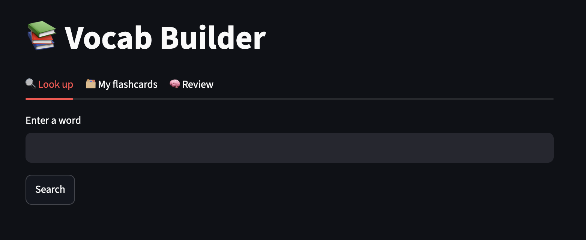

# Vocab Builder

## Live demo
https://vocab-builder.streamlit.app/

A command-line vocabulary tool built in Python. Look up any English word, see its meaning and an example sentence, and save it to a flashcard file for later review.

## What it does

- Looks up a word using **live data** from the [Free Dictionary API](https://dictionaryapi.dev)
- Shows the part of speech, definition, and an example sentence
- Saves words to a local `flashcards.json` file (duplicates are skipped)
- Includes a review mode that quizzes you on your saved flashcards
- Handles words that are not found and network errors

## API used

[Free Dictionary API](https://dictionaryapi.dev): free, no API key required.

Endpoint: `https://api.dictionaryapi.dev/api/v2/entries/en/<word>`

## Requirements

- Python 3.8 or newer
- Git
- Internet connection (the data is fetched live)

## Installation

```bash
# 1. Clone the repository
git clone https://github.com/YOUR_USERNAME/vocab-builder.git
cd vocab-builder

# 2. Create a virtual environment
python -m venv .venv

# 3. Activate it
# Mac/Linux:
source .venv/bin/activate
# Windows (PowerShell/CMD):
.venv\Scripts\activate

# 4. Install dependencies
pip install -r requirements.txt
```

## How to run

```bash
python vocab.py
```

On Mac/Linux, use `python3 vocab.py` if `python` is not found.

You will see a menu:

```
1. Look up a word
2. Review flashcards
q. Quit
```

- **1**: type a word, read its meaning, then choose `y` to save it as a flashcard.
- **2**: go through your saved flashcards. Press Enter to reveal each meaning.
- **q**: quit the program.

## Sample output

```
=== Vocab Builder ===
1. Look up a word
2. Review flashcards
q. Quit
Choose: 1
Enter a word: serendipity

Word: serendipity (noun)
Meaning: The faculty of making fortunate discoveries by accident.
Example: No example available

Save as flashcard? (y/n): y
Saved to flashcards.json

=== Vocab Builder ===
1. Look up a word
2. Review flashcards
q. Quit
Choose: 2

What does 'serendipity' mean? (press Enter to reveal)
The faculty of making fortunate discoveries by accident.
Example: No example available
```

## Saved data format

Flashcards are stored in `flashcards.json`:

```json
[
  {
    "word": "serendipity",
    "part_of_speech": "noun",
    "definition": "The faculty of making fortunate discoveries by accident.",
    "example": "No example available"
  }
]
```

## Project structure

```
vocab-builder/
├── vocab.py            # main program
├── requirements.txt    # dependencies (requests)
├── flashcards.json     # saved flashcards (created on first save)
├── .gitignore
└── README.md
```

## Error handling

- Word not found: shows "Word not found. Try another."
- No internet or timeout: shows a network error message instead of crashing
- Duplicate word: shows "Already in your flashcards."

## Author

## Word of the Day
The Streamlit app includes a **Word of the Day** tab. It picks a word from `words.txt` (100 difficult words) based on the date, and a button shows a random one. You can save any word as a flashcard.

Your Name: [GitHub profile](https://github.com/YOUR_USERNAME)
## Web interface (Streamlit)

```bash
streamlit run app.py
```

Opens in your browser with three tabs: **Look up**, **My flashcards**, and **Review**.
The terminal version still works with `python3 vocab.py`.


